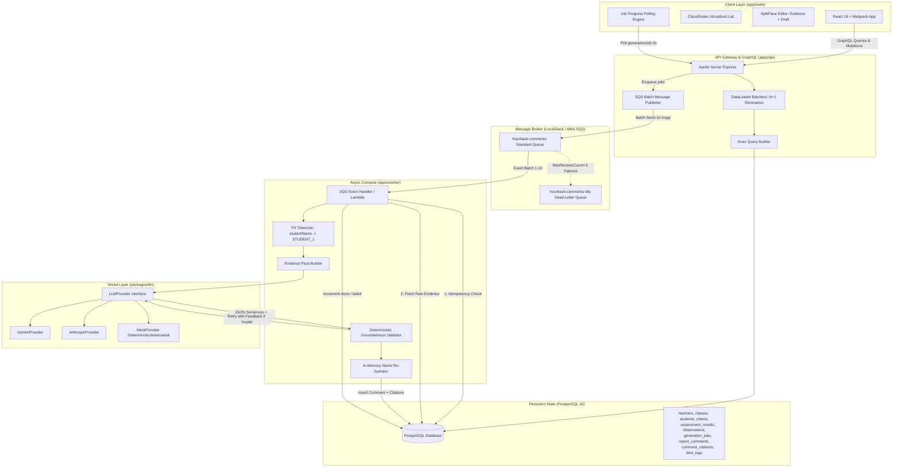

# HourBack — Architecture Specification

## 1. Executive Summary
**HourBack** is an AI progress-report comment copilot designed for teachers in criteria-based K-12 learning environments (e.g., IB PYP / MYP ATL frameworks). It reduces comment writing time from ~7–10 minutes per student to under 1–2 minutes of review and editing, while keeping the teacher firmly in the loop.

### Core Guarantees:
1. **Zero Hallucination / 100% Groundedness Enforced**: Every generated sentence must cite at least one specific piece of evidence (`assessment_result` or teacher `observation`).
2. **Deficit-Language & Comparison Prohibition**: Deterministic rule-based filter rejects deficit labels (*"lazy"*, *"weak"*, *"failing"*) and peer comparisons (*"better than peers"*), ensuring positive, constructive tone.
3. **FERPA / GDPR / DPDP Privacy Boundary**: Student PII (name, preferred name) is tokenized into opaque tokens (`STUDENT_1`) prior to entering the LLM boundary. Re-hydration happens in-memory on the worker before database storage.
4. **Resilient Asynchronous Execution**: Mass comment generation is distributed across SQS queues with Dead Letter Queues (DLQ) and idempotent execution.

---

## 2. System Architecture & Component Interaction



---

## 3. End-to-End Data Pipeline

### Step 1: Bulk Generation Trigger
1. Teacher selects Class (e.g., Grade 5A Math) and Report Period (e.g., Semester 1).
2. Teacher clicks **"Generate All"**, selecting Tone (`warm` | `formal` | `encouraging`) and Length (`short` | `medium` | `long`).
3. Client fires mutation `generateComments(classId, periodId, tone, length)`.
4. API creates a `generation_jobs` record (`status: running`, `total: N`, `done: 0`, `failed: 0`).
5. API batches SQS messages (up to 10 messages per batch via `SendMessageBatchCommand`).
6. API returns the `generation_jobs` object immediately to the client.

### Step 2: Client Progress Tracking
1. Client stores `activeJobId` in Redux state.
2. Client polls `generationJob(jobId)` query every 2.5–3 seconds.
3. Live progress bar and ARIA live announcement update as `done` increments.
4. Class roster rows update comment status chips optimistically.

### Step 3: Worker Processing & Privacy Guardrails
1. SQS invokes worker with a batch of messages.
2. **Idempotency Check**: Worker queries `report_comments` for `(student_id, period_id)`. If exists, message is acknowledged and skipped immediately.
3. **Data Loading**: Worker pulls student assessment levels, rubric criteria descriptors, and teacher observations.
4. **PII Tokenization**: Real names (*"Aarav Sharma"*, *"Aarav"*) are replaced with opaque token `STUDENT_1` across all evidence content.
5. **Prompt Packaging**: Assembles strictly typed `EvidencePack` conforming to Zod schema.
6. **LLM Generation**: Calls `LLMProvider.generate(pack)`. Returns JSON with schema:
   ```json
   {
     "sentences": [
       {
         "text": "STUDENT_1 demonstrated strong conceptual understanding when multiplying fractions.",
         "evidence_ids": ["c3b87932-1b1e-45fa-8025-a131b26c6d02"]
       }
     ]
   }
   ```
7. **Deterministic Validation**:
   - Every sentence must contain >= 1 valid evidence ID present in the pack.
   - Sentence count must be within target length limits.
   - Scans for forbidden deficit keywords (`lazy`, `weak`, `struggling`, `failed`, `cannot`).
   - Scans for student comparison phrases (`better than`, `worse than`, `compared to other`).
   - If invalid: re-prompts LLM once with `validatorFeedback` containing the precise validation error list.
   - If retry fails: stores with `status: flagged` for teacher manual attention.
8. **Name Rehydration**: Replaces `STUDENT_1` with student's preferred name in-memory.
9. **Atomic Storage**: Inside a DB transaction, inserts `report_comments` and multiple `comment_citations` linking sentence index to evidence source.
10. **Job Increment**: Increments `done` or `failed` counter on `generation_jobs`.

### Step 4: Teacher-in-the-Loop Review & Time Tracking
1. Teacher selects student in virtualized roster.
2. **SplitPane Editor**:
   - **Left Pane**: Editable draft comment with tone selector and groundedness score badge (e.g., 95% grounded).
   - **Right Pane**: Student evidence items (assessment results + timestamped observations).
   - **Interactive Citation Linkage**: Hovering or clicking a sentence highlights the exact evidence card cited on the right pane.
3. Teacher can edit text (Levenshtein edit distance tracked).
4. Stopwatch logs time spent.
5. Teacher clicks **"Approve Comment"**: mutation sets `status: approved` and writes a `time_logs` record (`mode: assisted`, `seconds: elapsed`).
6. Analytics card recalculates real-time time saved vs manual baseline.
